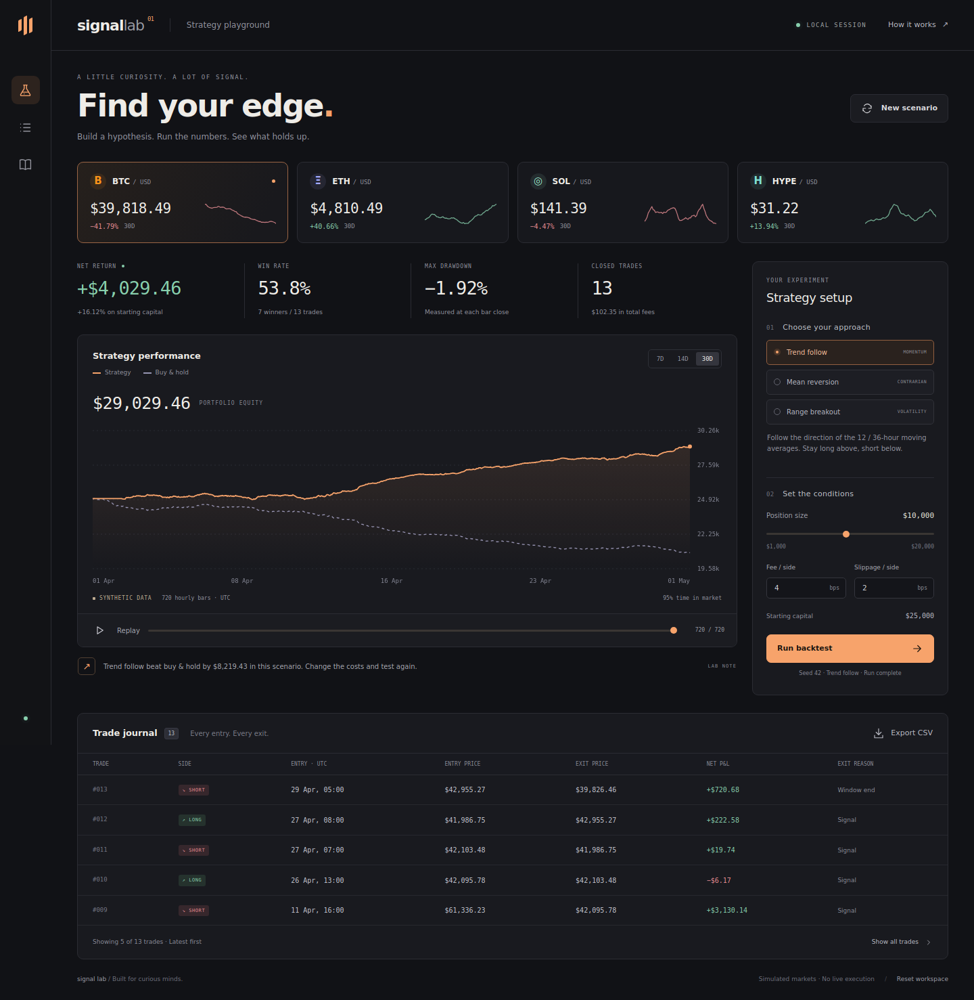

<p align="center"></p>
<h1 align="center">Signal Lab</h1>
<p align="center"><strong>A little curiosity. A lot of signal.</strong></p>
<p align="center">A zero-dependency trading strategy playground. Generate a market, test an idea,<br>and watch execution costs change the result.</p>
<p align="center"><a href="#quick-start">Quick start</a> · <a href="#inside-the-lab">Features</a> · <a href="#how-the-math-works">The math</a> · <a href="QUICKSTART_UA.md">Українською</a></p>



**This is a working software demo built on synthetic data.** Market names are labels, prices are generated, and displayed returns are not historical results or evidence of a profitable strategy.

## Quick start

Requires **Node.js 22 or later**. There are no packages to install.

```bash
cd signal-lab
npm start
```

Open **http://localhost:4173**. No credentials, accounts, backend, or configuration file setup required. After downloading the repository, the app works offline.

Port in use? Run `npm start -- --port 4174`.

## Inside the lab

| Feature | What it does |
| --- | --- |
| Four synthetic markets | BTC, ETH, SOL, and HYPE with different volatility profiles |
| Three strategies | Moving-average trend following, mean reversion, and range breakout |
| Real accounting | Next-open execution, fees on both sides, adverse slippage, and marked equity |
| Equity comparison | Interactive Canvas chart against buy & hold, with hover details |
| Replay | Reveal the completed equity curve or scrub to a particular bar |
| Scenario generation | Change one seed to generate a fresh, reproducible market |
| Adjustable assumptions | $1k–$20k notional, 0–50 bps fees and slippage, 7/14/30-day windows |
| Trade journal | Both long and short fills, net P&L, and a complete CSV export |
| Reproducible exports | Download a JSON run with settings, bars, metrics, and trades |
| Local persistence | Last applied settings stay in your browser; reset in one click |
| Responsive design | Desktop and mobile layouts, semantic controls, and keyboard focus |
| GitHub ready | MIT license, test workflow, issue template, and contribution notes |

**Try it:** choose a market → choose an approach → change costs → **Run backtest**. Market and window changes run immediately. Strategy and cost changes are applied with the Run button.

Shortcuts: **R** runs the backtest; **N** generates a new scenario. They are disabled while typing or reading the methodology dialog.

## Strategies

| Strategy | Entry / target rule | Exit rule |
| --- | --- | --- |
| Trend follow | Long when the 12-bar SMA exceeds the 36-bar SMA; short when below | Reverse on the opposite target; flat if equal |
| Mean reversion | Long below the 24-bar mean minus 1.5 population standard deviations; short above the mean plus 1.5 deviations | Return to cash at the mean, or reverse on an opposite extreme |
| Range breakout | Long on a close above the previous 24 bars' highs; short below their lows | Hold until the opposite breakout |

Moving-average and reversion windows include the just-completed bar. Breakout windows exclude it. Every target is computed after a bar closes and executed at the **following bar's open**.

Each window starts with fresh indicator history and an empty portfolio. Therefore the last 7 days of a 30-day run need not match a separate 7-day run.

## How the math works

The starting portfolio is **$25,000**. Only one position can be open. Position size means entry notional, not collateral or cash committed to a leveraged contract. A short is modeled as a signed position for P&L accounting.

```text
fee rate      = fee bps / 10,000
slippage rate = slippage bps / 10,000
side          = +1 for long, -1 for short

entry fill = next open × (1 + side × slippage rate)
notional   = min(requested position size, available equity / (1 + fee rate))
quantity   = notional / entry fill
entry fee  = notional × fee rate

exit fill = execution price × (1 - side × slippage rate)
exit fee  = quantity × exit fill × fee rate
gross P&L = side × quantity × (exit fill - entry fill)
net P&L   = gross P&L - entry fee - exit fee
```

Entry fees reduce balance immediately. Gross P&L and exit fees settle when a position closes. Between fills, equity equals the realized balance plus open P&L marked at the bar close; future exit costs are not reserved. Every open position is closed at the final bar's close. Consequently:

```text
final equity = starting capital + sum(closed trades' net P&L)
net return   = (final equity / starting capital - 1) × 100%
drawdown     = (running equity peak - current equity) / running equity peak × 100%
win rate     = trades with net P&L > 0 / closed trade count × 100%
```

All timestamps are UTC. A bar's `time` is its **open**. Curve points and final liquidation use its **close** time. Prices are not rounded during calculation; rounding is for display and exports only.

Buy & hold enters long on the second bar's open, uses the same position cap and cost assumptions, and exits at the final close. It leaves the rest of the starting portfolio in cash. Strategies may enter later due to indicator warm-up. Reversals charge an exit fee and a new entry fee.

Replay only reveals the equity curve. Summary cards and journal always describe the complete run. The chart includes starting capital in the first bar's close point.

### Deliberate model limits

- Data comes from a seeded random generator with changing drift. It has no connection to live markets or historical exchange data.
- There is no order book, queue priority, funding, borrow fee, latency, stop order, or liquidation model.
- Position size is capped at available equity at entry. The simplified short model can still lose more than its notional during a sufficiently large adverse move; negative equity is retained and prevents new entries.
- Drawdown is sampled at bar closes. Intrabar extremes and the path within a bar are not modeled.
- No confidence intervals, annualized Sharpe ratios, optimization, or claims about future returns are inferred from this demo.

## Development

```bash
npm run check   # JavaScript syntax validation
npm test        # Built-in Node test runner
npm run build   # Copy only the application files to dist/
```

No transpiler, package manager install, or third-party runtime is needed. Node powers the local server and test runner; the application uses browser-native JavaScript modules, CSS, SVG, and Canvas.

| Location | Responsibility |
| --- | --- |
| `src/config.js` | Default settings, markets, and strategy parameters |
| `src/engine.js` | Deterministic data, targets, execution, metrics, and CSV |
| `src/chart.js` | Canvas rendering, hover, and high-DPI sizing |
| `src/app.js` | UI state, controls, exports, replay, and local storage |
| `src/styles.css`, `src/tokens.css` | Layout, responsive design, and theme |
| `scripts/` | Local server, syntax check, and static build |
| `test/` | Accounting, causality, timestamps, and server checks |
| `.github/` | CI and collaboration templates |

Tests use hand-calculated P&L examples, verify fees and adverse fills in both directions, check that future data cannot rewrite earlier signals, reconcile every completed trade to portfolio equity, and exercise the preview server's public-file boundaries. CI runs on Node 22 and 24.

### Customize it

- Edit `src/tokens.css` to change the palette.
- Edit `src/config.js` to change starting capital, market profiles, or strategy periods.
- Add a strategy definition to `STRATEGIES` and its causal target rule to `createTargets()`.
- Supply valid, evenly spaced OHLC bars to `backtest()` to experiment with another data source. The current UI intentionally uses only generated data.

## Put it on GitHub

Create an **empty repository** named `signal-lab`, then run the following inside this folder. Replace `YOUR_USERNAME` with your GitHub username.

```bash
git init -b main
git add .
git commit -m "Initial release: Signal Lab"
git remote add origin https://github.com/YOUR_USERNAME/signal-lab.git
git push -u origin main
```

Suggested description:

> Zero-dependency strategy playground with synthetic markets, transparent backtests, and interactive equity curves.

Suggested topics: `javascript`, `backtesting`, `trading`, `simulation`, `canvas`, `zero-dependencies`, `github-pages`.

To publish a demo with [GitHub Pages](https://docs.github.com/en/pages/quickstart), select **Settings → Pages → Deploy from a branch → main → / (root)**. The root already contains the static entry point and `.nojekyll`; the app's relative paths also work under a repository URL. Publishing is optional and has not been performed as part of this archive.

The repository's CI uses GitHub's official [checkout](https://github.com/actions/checkout) and [setup-node](https://github.com/actions/setup-node) actions.

## License

[MIT](LICENSE). Make it yours.
